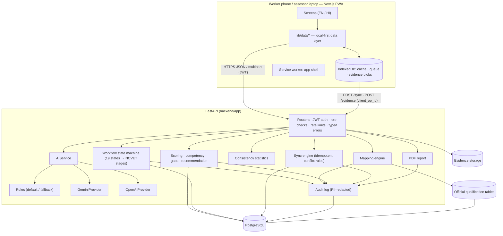
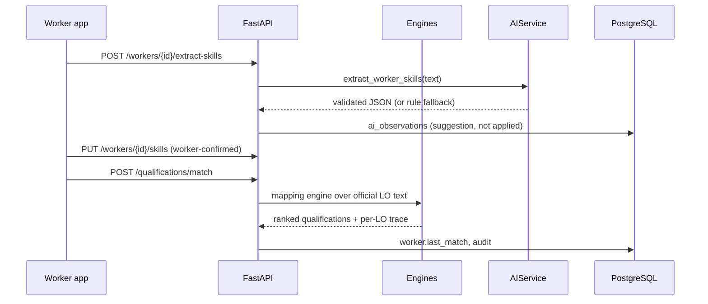
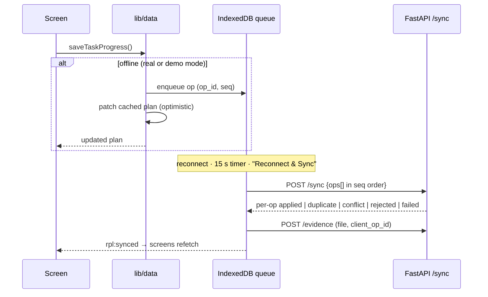

# Architecture

RPL-Sahayak AI is a monorepo with a Next.js worker/assessor/admin web app (installable PWA, offline-capable) and a
FastAPI service over PostgreSQL. Deterministic engines compute every number; an AI layer only *suggests* and
*explains*, behind one provider-agnostic interface.

## Layers

| Layer | Location | Responsibility |
|---|---|---|
| Screens | `frontend/app/{worker,assessor,admin,demo}`, public `/`, `/about`, `/how-it-works` | Mobile-first worker flow; data-dense assessor/admin workspace |
| Data layer | `frontend/lib/data/*.ts` | The only place screens get data; online → API, offline → queue + optimistic cache |
| Offline | `frontend/lib/offline/*`, `public/sw.js` | IndexedDB (Dexie), sync queue with backoff, demo network mode, app-shell caching |
| API | `backend/app/api/routes/*.py` | Validation (Pydantic), role checks, workflow guards, audit |
| Domain services | `backend/app/services/*.py` | Mapping, readiness, scoring, gaps, recommendation, consistency, report, sync |
| AI | `backend/app/ai/*`, `prompts/*.txt` | `AIService` → rules / Gemini / OpenAI; JSON validation, one retry, rule fallback |
| Data | `data/` | Official (`sources/`, `qualifications/`), project-authored (`assessment/`), synthetic + simulation (`demo/`) |
| Persistence | PostgreSQL via SQLAlchemy 2 + Alembic | 24 tables; `data_origin` on every data row |

## Request path (online)

## Offline path

Details: [offline-sync.md](offline-sync.md).

## Workflow states

`REGISTERED → PROFILE_COMPLETE → EXPERIENCE_DECLARED → SKILLS_EXTRACTED → SKILLS_CONFIRMED → QUALIFICATION_MATCHED →
QUALIFICATION_CONFIRMED` (worker), then `PLAN_CREATED → SELF_ASSESSED → READINESS_EVALUATED → TASKS_IN_PROGRESS →
EVIDENCE_SUBMITTED → AI_EVIDENCE_REVIEWED → ASSESSOR_SCORING → SCORED → RECOMMENDATION_GENERATED →
UNDER_ASSESSOR_REVIEW → DECIDED → REPORT_ISSUED` (assessment plan). States only move forward (a new experience
declaration is the one explicit reset); every transition is audited; each maps to an NCVET Annexure-1 stage
(Enrolment, Orientation, Assignment of RPL assessor, Assessment, Certification & Feedback).

## Data model (main tables)

`users`, `roles` · `trades`, `qualification_sources`, `qualifications`, `qualification_competencies` (one row per
learning outcome), `qualification_nos` · `worker_profiles`, `worker_experiences` (append-only versions),
`worker_skills` · `assessment_tasks`, `assessment_criteria` · `assessment_plans`, `assessment_attempts`, `evidence`,
`ai_observations`, `assessor_scores` (separate `ai_suggested_score` and `final_score`), `competency_results`,
`skill_gaps`, `recommendations`, `assessor_decisions` · `sync_queue`, `audit_logs`, `consistency_ratings`.
Migrations: `backend/migrations/` (Alembic).

## Adding a trade

A trade is data, not code: add the official qualification PDF to `data/sources/`, extend
`scripts/ingest_official_qualifications.py` with its verified summary fields, and add
`data/assessment/<trade>_tasks.json` (tasks, criteria, anchors, evidence requirements) plus a lexicon. The loader
marks a trade assessable when a task bank exists; matching, scoring, gaps, recommendation, reports, offline sync and
consistency analytics work unchanged.

## Security

JWT bearer auth with role claims; bcrypt password hashes; role and ownership checks on every route (see
`backend/tests/test_permissions.py`); upload type decided by file signature, size-limited, path-safe storage;
rate limits on sign-in, registration and AI routes; typed JSON errors without stack traces; API keys only in the
server environment; audit log redacts names, mobile numbers and locality; demo endpoints disabled unless
`DEMO_MODE_ENABLED=true`.
