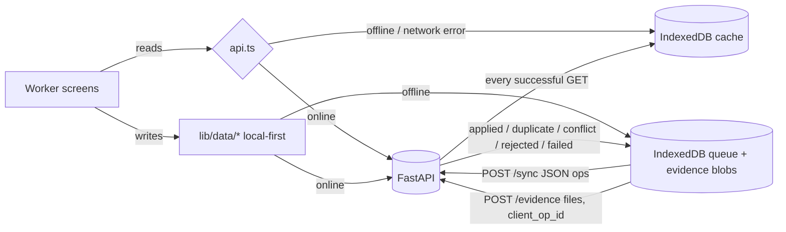

# Offline operation & synchronisation

RPL assessments happen at workplaces and field camps with weak or no connectivity. The worker flow is therefore
**local-first**: the device keeps working without the server and synchronises later.

## Components

| Piece | File | Role |
|---|---|---|
| Device store | `frontend/lib/offline/db.ts` | Dexie (IndexedDB) tables: `cache` (last GET responses, per user), `queue` (pending operations), `evidence` (photo/video blobs captured offline) |
| Network mode | `frontend/lib/offline/network.ts` | `isOnline() = navigator.onLine && !demoOffline` |
| API client | `frontend/lib/api.ts` | GETs are cached on success and served from cache when offline |
| Local-first writes | `frontend/lib/data/{worker,assessment,evidence}.ts` | Profile update, experience declaration, task checklist/finish, evidence upload: queued offline + cached screens patched optimistically |
| Sync engine | `frontend/lib/offline/sync.ts` | Batch flush, retry with backoff, status store |
| UI | `frontend/components/SyncStatus.tsx` | Status chip, offline banner, sync panel with **Demo network mode** and **Reconnect & Sync** |
| Server | `backend/app/api/routes/sync.py` | Applies ops idempotently; conflict rules |
| App shell | `frontend/public/sw.js`, `app/manifest.ts` | Service worker (production builds) so the app opens with no connection |

## Rules

- **Idempotency.** Every queued item has a UUID (`op_id`). JSON ops are logged in `sync_queue.client_op_id` (unique);
  evidence uses `evidence.client_op_id` (unique). A retried item returns `duplicate` and is never applied twice.
- **Order.** JSON ops are sent in creation order in one batch, then evidence files (so their context exists).
- **Conflicts.** Worker-owned data uses last-writer-wins by client timestamp: if the server copy changed after the
  device edit, the op returns `conflict`, the server value stays, and the device payload is kept in
  `sync_queue.result` for review.
- **Server-owned data.** Scores, decisions and recommendations are assessor-owned and server-authoritative; any device
  op touching them is `rejected`.
- **Partial failure.** Each op reports its own status; one invalid op does not block the rest.
- **Retry.** Network errors keep the op pending with exponential backoff (2 s, 4 s, 8 s … max 60 s); after 8 attempts
  it becomes 🔴 failed and can be retried from the panel. Validation failures and rejected files are not retried.
- **Triggers.** Sync runs on reconnect, when the demo switch returns to Online, every 15 s while items are pending,
  and on **Reconnect & Sync**.
- **Status chip.** 🟢 ✓ Synced · 🟡 ● Sync pending (n) / Offline (n) · 🔴 ✕ Sync failed (n): always icon + text.
- **Audit.** Synced changes are written to `audit_logs` with `via = 'sync'`, plus one `sync.completed` summary per batch.

## What needs the network

AI skill extraction, qualification matching and plan creation run on the server and need a connection. Offline the
worker can continue the practical assessment: tick task steps, finish tasks, capture evidence, edit the profile,
and write a new experience declaration (extraction runs after sync).

## Demo script (≈ 60 s)

1. Sign in as a worker who has started the practical assessment; open **Tasks** and **Evidence** once (caches them).
2. Tap the 🟢 chip → **Demo network mode → Offline**. The offline banner appears; API calls behave like a lost connection.
3. Add photos on **Evidence** ("Saved on this phone…") and finish tasks on **Tasks**. The chip counts up: *Offline (7)*.
4. Open the chip → **Reconnect & Sync** → e.g. *"4 records synchronized · 3 evidence items uploaded · 0 conflicts"* (counts come from the server's per-op results).
5. The assessor's scoring workspace now shows the evidence, marked "captured offline".

## Verification status

| Check | How | Result |
|---|---|---|
| Server rules | `backend/tests/test_sync.py` (idempotency, conflict, rejection, partial failure, staff blocked) | ✅ |
| Queue logic | `frontend/__tests__/syncQueue.test.ts` (Vitest + fake-indexeddb): offline queueing, ordered batch, backoff, max attempts, evidence success/failure | ✅ |
| End-to-end demo mode | In-app browser, phone viewport: 3 photos + 4 finished tasks offline → Reconnect & Sync → server shows 4 `SUBMITTED` tasks, 3 evidence rows `captured_offline=true`, 4 `applied` sync rows, audit `via=sync` | ✅ |
| Service worker (true device offline) | Production build serves `/sw.js` (200, JS) and the manifest; the embedded browser pane used for testing refuses service-worker registration ("unknown error fetching the script") | ⚠ to verify in desktop Chrome: `npm run build && npm start`, open DevTools → Application → Service workers, then Network → Offline and reload |
