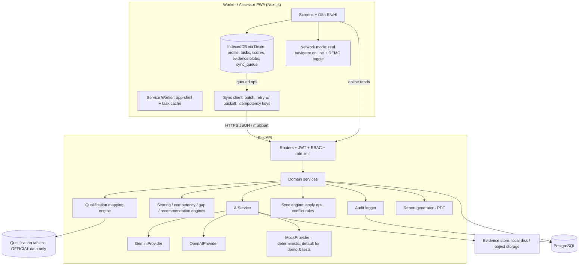

# RPL-Sahayak AI — Project Blueprint

> AI-Assisted Prior Learning Assessment & Assessor Support Platform
> SIH 2026 · Problem Statement SIH26242 · Prototype blueprint (Phase 0)
> Status: **prototype**. Nothing here is an NCVET/DGT-approved system or integration.

RPL-Sahayak AI turns informal work experience into a structured, evidence-backed competency
profile aligned to an official NSQF qualification, while the final certification decision stays
with an authorised human assessor.

---

## 0. Phase 0 audit result

| Item | Finding |
|---|---|
| Existing project | None. Greenfield repo created at `~/rpl-sahayak`. |
| Toolchain on dev machine | Python 3.13.5, Node 24.13, npm 11.7, git 2.46. **No PostgreSQL, no Docker installed.** |
| Consequence | PostgreSQL remains the target DB (SQLAlchemy + Alembic, Postgres dialect). Phase 1 will try an embedded Postgres (`pgserver` pip package) for local dev; if unavailable on Windows, a `docker/docker-compose.yml` is provided for Postgres and SQLite is used **only** for the automated test suite. This is stated in the README, not hidden. |
| Official sources | Downloaded and hashed into `data/sources/` on 2026-10-01 (see `docs/dataset.md`). Electrician QF verified page-by-page. |

### Verified official facts the design depends on

| Fact | Value | Source |
|---|---|---|
| Qualification | ELECTRICIAN, code **DGT/1001**, NCVET code **2022/POW/DGT/06309**, **NSQF Level 4** | QF Electrician p.1–2 |
| NCO | 7411.0100 Electrician General; 7412.0200 Electrical Fitter | QF p.2 |
| Structure | 30 trade learning outcomes (LOs) each tagged with NOS code(s); 12 employability-skill LOs | QF p.4–6, 11–20 |
| Notional hours | 2400 (2 yrs) + 300 OJT | QF p.3, 6 |
| RPL arrangement | "Yes" — via DGT *Guidelines for Private candidate* | QF p.3 item 17 |
| RPL eligibility (Category IV, other candidates) | min entry qualification, **age ≥ 21**, **≥ 3 years** relevant experience in registered establishment | QF p.8 |
| Entry qualification | 10th pass with Science & Mathematics | QF p.3 |
| Formative assessment dimensions | Safety consciousness 15, Workplace hygiene 5, Attendance 10, Following manuals 5, Application of knowledge 10, Tool handling 10, Economical use of materials 5, Working strategy 10, Quality of workmanship 15, Viva 15 | QF p.10 |
| Pass mark reference | Trade practical & formative: 60% | QF p.9 |
| RPL direct-assessment rule | Assessor ensures applicant has met **> 70 %** of declared learning outcomes for direct RPL assessment | NCVET RPL Guidelines (Gazette 19-Jun-2024) §6.2(c) |
| RPL process, NSQF 4 without formal education | Awareness → Enrolment → Orientation → Assignment of RPL specialised assessor → Assessment (practical) → Certification & Feedback; "Not suitable" → Skill-gap training | Gazette Annexure-1, Flowchart 3 |
| Mapping rule, levels 1–3.5 | Mapping of experiential learning > 70 % of LOs → direct assessment; < 70 % → upskilling | Gazette Annexure-1, Flowchart 1 |
| Comparison qualification | WIREMAN, **DGT/1009**, NCVET **2022/POW/DGT/06310**, NSQF 4 | QF Wireman p.1–2 |

**Known source inconsistency (preserved, not "fixed"):** for several Electrician LOs the NOS code in the
summary table (§20) differs from the LO/assessment-criteria table (e.g. LO7 `PSS/N9403` vs `N/A`;
LO9, 18, 19, 21, 22, 23, 25, 28 likewise). The dataset stores both fields (`nos_codes_summary`,
`nos_codes_lo_table`) and flags the mismatch.

---

## 1. Architecture



Principles:
- **Deterministic core, AI at the edges.** Scores, competency %, gaps, readiness and recommendation
  are computed by transparent code. AI produces *suggestions* (extracted skills, evidence
  observations, narrative summaries) that are stored separately and never written into the final
  score fields.
- **Configurable trade pack.** A trade = `qualification + LOs/NOS + tasks + rubric + evidence
  requirements + lexicon`. Electrician is the only fully built pack; Wireman exists as official
  qualification data for ranking only.
- **Provider isolation.** No provider SDK is imported outside `backend/app/ai/providers/`.

### Tech stack

| Layer | Choice | Why |
|---|---|---|
| Frontend | Next.js (App Router) + TypeScript + Tailwind (custom tokens, no UI kit look) | Route list in spec maps 1:1 to App Router |
| Offline | Hand-written service worker + Dexie (IndexedDB) | Transparent, demoable, no magic plugin |
| Charts | Hand-rolled SVG (radar, bars, dot/strip plots) | Tiny payload for low bandwidth; fully data-driven |
| i18n | Small typed dictionary (`en`, `hi`) + `useT()` hook | No heavy dependency |
| Backend | FastAPI, Pydantic v2, SQLAlchemy 2, Alembic | Spec |
| Auth | JWT (PyJWT), bcrypt, role claims; slowapi rate limiting on auth/AI routes | Spec §34 |
| DB | PostgreSQL 16 | Spec |
| AI | `AIService` → Gemini / OpenAI / Mock; prompts in `/prompts/*.txt`; Pydantic-validated JSON | Spec §31–33 |
| Matching | Lexicon-normalised token + phrase similarity (TF-IDF cosine over LO text) — no training | Rule 5 |
| Reports | ReportLab PDF | Server-side, works without client libs |
| Tests | pytest (+ httpx TestClient), Vitest for offline queue logic, Playwright smoke if time | Spec §45 |

---

## 2. Modules

| # | Module | Responsibility | Deterministic / AI |
|---|---|---|---|
| M1 | Auth & RBAC | login, JWT, role guard (worker/assessor/admin) | Det. |
| M2 | Worker onboarding | profile, experience declaration, documents, language | Det. |
| M3 | Experience extraction | free text (+ optional voice transcript) → structured skills/tools/tasks/safety/learning mode + confidence + missing info; worker confirms/edits | AI suggest → human confirm. Rule-based fallback. |
| M4 | Qualification mapping | rank qualifications; per-LO coverage; matched/unclear lists | Det. (AI only explains) |
| M5 | Self-assessment & readiness | LO-level "I can do this" checklist; eligibility checks (age, experience, education) from QF Category IV; readiness pathway (>70 % LO rule) | Det. |
| M6 | Assessment plan & tasks | generate plan from task bank for mapped LOs | Det. selection; AI may draft worker-friendly instructions |
| M7 | Guided practical tasks | step checklist, safety prompts, capture evidence per criterion | Det. |
| M8 | Evidence & AI evidence assistant | upload image/video/doc, validate, link to criterion, AI observation (observed / missing / safety concern / indicator / confidence) | AI suggest only |
| M9 | Standardised scoring | 0–4 rubric per criterion, weights, AI-suggested vs assessor-confirmed score stored separately | Det. |
| M10 | Competency & gap engine | task → LO competency → overall; required − demonstrated = gap; learning topics | Det.; AI narrative optional |
| M11 | Recommendation | Eligible / Not Yet Ready / Reassessment Suggested, with rule trace | Det. rules, explainable |
| M12 | Assessor review & decision | override any AI suggestion, comments, approve/reject/reassess | Human |
| M13 | Consistency analytics | baseline vs standardised multi-rater stats (SD, variance, range, pairwise agreement, weighted κ, Fleiss κ, ICC) | Det. from dataset |
| M14 | Offline & sync | IndexedDB, queue, retry, conflict resolution, demo toggle | Det. |
| M15 | Admin & audit | trades, QPs, LOs, tasks, rubrics, users, stats, sync status, audit log | Det. |
| M16 | Reports | PDF assessment report with AI-advisory disclaimer + audit metadata | Det. |
| M17 | Demo mode | one-click "Raj Kumar" scenario with pre-computed AI outputs | Det. |

---

## 3. Workflow state machine

Each worker assessment carries one `status`. Transitions are enforced server-side; every
transition writes an audit record. Mapping to the NCVET flowchart is shown in brackets.

```
REGISTERED                [Enrolment]
PROFILE_COMPLETE
EXPERIENCE_DECLARED
SKILLS_EXTRACTED          (AI suggestion stored)
SKILLS_CONFIRMED          (worker confirmed/edited — required before matching)
QUALIFICATION_MATCHED
QUALIFICATION_CONFIRMED
SELF_ASSESSED             [Pre-screening / self-assessment]
READINESS_EVALUATED       → DIRECT_ASSESSMENT | UPSKILLING_SUGGESTED   [>70 % rule]
PLAN_CREATED              [Orientation + assignment of assessor]
TASKS_IN_PROGRESS         [Assessment (practical)]
EVIDENCE_SUBMITTED
AI_EVIDENCE_REVIEWED      (AI observations exist; advisory)
ASSESSOR_SCORING
SCORED
RECOMMENDATION_GENERATED
UNDER_ASSESSOR_REVIEW
DECIDED                   → APPROVED_FOR_CERTIFICATION | NOT_YET_COMPETENT | REASSESSMENT_REQUESTED
REPORT_ISSUED             [Certification & Feedback — prototype report only, not a certificate]
```

`UPSKILLING_SUGGESTED` does not dead-end: the worker may still request assessment (assessor
discretion), mirroring the guideline's "may take upskilling module and thereafter appear".

---

## 4. Database schema (PostgreSQL)

All tables: `id` (UUID PK unless noted), `created_at`, `updated_at`; soft status fields where noted.
Tables holding demo rows have `data_origin` ∈ {`official`, `synthetic`, `simulation`, `user`}.

| Table | Key columns | Notes |
|---|---|---|
| `roles` | `code` PK (worker/assessor/admin), `label` | |
| `users` | `email`/`mobile` (unique), `password_hash`, `role_code` FK, `full_name`, `preferred_language`, `is_active`, `data_origin` | |
| `trades` | `code` (unique, e.g. `ELECTRICIAN`), `name`, `is_assessable` | configurability hook |
| `qualification_sources` | `source_name`, `url`, `file_path`, `sha256`, `retrieved_at`, `source_type` | provenance |
| `qualifications` | `title`, `qualification_code` (DGT/1001), `ncvet_code`, `nsqf_level`, `nco_codes` JSONB, `occupations` JSONB, `job_description`, `nature`, `awarding_body`, `notional_hours` JSONB, `entry_requirements`, `min_age`, `progression` JSONB, `rpl_available`, `rpl_notes`, `approval_note`, `trade_id` FK, `source_id` FK | official only |
| `qualification_nos` | `qualification_id` FK, `nos_code`, `mapped_lo_numbers` | |
| `qualification_competencies` | `qualification_id` FK, `lo_number`, `year`, `title`, `assessment_criteria` JSONB, `nos_codes_summary` JSONB, `nos_codes_lo_table` JSONB, `nos_mismatch` bool, `skill_hours`, `knowledge_hours`, `category` (trade/employability), `keywords` JSONB (derived, labelled) | one row per LO |
| `worker_profiles` | `user_id` FK, demographics (age, gender, state, district, locality), `occupation`, `years_experience`, `current_employer`, `previous_employers` JSONB, `informal_training`, `education_level`, `has_science_maths`, `existing_certificates` JSONB, `tools` JSONB, `typical_work`, `status`, `data_origin` | |
| `worker_experiences` | `worker_id` FK, `raw_text`, `input_mode` (text/voice), `language`, `version` | declaration never mutated; edits create new version |
| `worker_skills` | `worker_id` FK, `experience_id` FK, `kind` (skill/tool/task/equipment/safety), `label`, `normalized_label`, `source` (ai/worker/assessor), `confirmed` bool, `confidence` | |
| `assessment_plans` | `worker_id` FK, `qualification_id` FK, `assessor_id` FK users, `status` (state machine), `pathway`, `match_snapshot` JSONB, `readiness_snapshot` JSONB | the "assessment" |
| `assessment_tasks` | `trade_id` FK, `task_code` (T01…), `title`, `title_hi`, `description`, `lo_numbers` JSONB, `weight`, `evidence_required` JSONB, `safety_requirements` JSONB, `scoring_scale` JSONB, `source_ref` | from `data/assessment/electrician_tasks.json` |
| `assessment_criteria` | `task_id` FK, `criterion_code` (C04.2), `text`, `weight`, `is_safety_critical`, `qf_dimension` (official formative dimension), `qf_criterion_ref` | |
| `assessment_attempts` | `plan_id` FK, `task_id` FK, `status`, `started_at`, `completed_at`, `client_op_id` (idempotency) | |
| `evidence` | `plan_id` FK, `attempt_id` FK, `criterion_id` FK nullable, `kind` (image/video/document/audio), `mime`, `size_bytes`, `sha256`, `storage_path`, `caption`, `captured_offline` bool, `upload_status`, `data_origin` | |
| `ai_observations` | `evidence_id` FK nullable, `plan_id` FK, `kind` (skill_extraction/evidence/summary/recommendation_narrative), `provider`, `model`, `prompt_file`, `prompt_version`, `output` JSONB, `confidence`, `valid` bool, `fallback_used` bool | advisory, immutable |
| `assessor_scores` | `plan_id`, `attempt_id`, `criterion_id` FKs, `ai_suggested_score` nullable, `ai_observation_id` FK nullable, `final_score` nullable, `weight`, `assessor_note`, `confirmed_by` FK, `confirmed_at`, `overrode_ai` bool | AI vs human in separate columns |
| `competency_results` | `plan_id` FK, `lo_number` / `competency_key`, `score_pct`, `required_pct`, `evidence_count`, `computed_at`, `inputs_hash` | |
| `skill_gaps` | `plan_id` FK, `competency_key`, `required`, `demonstrated`, `gap`, `learning_topics` JSONB, `topic_source` (qualification LO text vs suggestion) | |
| `recommendations` | `plan_id` FK, `outcome` (ELIGIBLE/NOT_YET_READY/REASSESSMENT_SUGGESTED), `competency_coverage`, `evidence_coverage`, `rule_trace` JSONB, `narrative` | labelled AI-assisted |
| `assessor_decisions` | `plan_id` FK, `assessor_id` FK, `decision` (APPROVE/REJECT/REASSESS), `comments`, `decided_at` | the only "final" record |
| `sync_queue` | `client_id`, `client_op_id` (unique), `entity`, `op`, `payload` JSONB, `received_at`, `applied_at`, `status`, `conflict` JSONB | server side log of client ops |
| `audit_logs` | `actor_id`, `actor_role`, `action`, `entity`, `entity_id`, `before` JSONB, `after` JSONB (PII-redacted), `ip_hash`, `at` | append-only |
| `consistency_ratings` | `case_id`, `task_code`, `criterion_code`, `assessor_code`, `mode` (baseline/standardised), `score`, `data_origin='simulation'` | loaded from CSV |

Indexes: FKs; `assessment_plans(status)`, `assessment_plans(assessor_id,status)`, `evidence(plan_id)`,
`assessor_scores(plan_id)`, `audit_logs(entity,entity_id)`, `audit_logs(at)`, `sync_queue(client_op_id)` unique,
`consistency_ratings(mode,case_id)`.

---

## 5. API plan (FastAPI, `/api/v1` prefix, OpenAPI at `/docs`)

| Method & path | Role | Purpose |
|---|---|---|
| `POST /auth/login` | public | JWT (rate-limited) |
| `GET /auth/me` | any | current user |
| `POST /workers` / `GET /workers/{id}` / `PUT /workers/{id}` | worker(self)/assessor/admin | profile |
| `POST /workers/{id}/experience` | worker | new declaration version |
| `POST /workers/{id}/extract-skills` | worker | AI extraction → suggestion (not applied) |
| `PUT /workers/{id}/skills` | worker | confirm/edit extracted skills |
| `POST /workers/{id}/documents` | worker | upload doc → AI text extraction → claims to confirm |
| `GET /qualifications` / `GET /qualifications/{id}` | any | official data + source |
| `POST /qualifications/match` | worker/assessor | ranked matches with breakdown |
| `POST /assessments` | worker/assessor | create plan for confirmed qualification |
| `GET /assessments/{id}` | owner/assessor | full plan |
| `POST /assessments/{id}/self-assessment` | worker | LO checklist → readiness |
| `POST /assessments/{id}/start` | worker/assessor | → TASKS_IN_PROGRESS |
| `POST /assessments/{id}/tasks/{task_id}/score` | assessor | criterion scores (final) |
| `POST /assessments/{id}/recommendation` | assessor | compute recommendation |
| `GET /assessments/{id}/report.pdf` | owner/assessor/admin | report |
| `POST /evidence` | worker/assessor | multipart upload, type/size validated |
| `POST /evidence/{id}/analyze` | assessor/worker | AI observation |
| `GET /competencies/{assessment_id}` / `GET /skill-gaps/{assessment_id}` | owner/assessor | |
| `GET /assessor/candidates` | assessor | paginated table |
| `POST /assessor/decision` | assessor | final human decision |
| `GET /analytics/consistency` | assessor/admin | stats computed from dataset |
| `GET /analytics/dashboard` | assessor/admin | KPIs |
| `POST /sync` / `GET /sync/status` | any | batch ops, idempotent |
| `GET/POST/PUT /admin/...` | admin | trades, qualifications (read-mostly), tasks, rubrics, users, audit |
| `POST /demo/load` | public (demo only, env-gated) | load Raj Kumar scenario |

---

## 6. Mapping engine (M4)

Inputs: confirmed skills/tasks/tools, years of experience, occupation, education, age.
For each qualification `q`:

```
skill_sim      = coverage of q's LO keyword sets by worker skills+tools   (lexicon-normalised, TF-IDF cosine per LO, best-match)
task_sim       = similarity of worker "typical work"/tasks to q's assessment-criteria text
experience_rel = min(1, years / 3)   × relevance factor (occupation keywords)   # 3 yrs = QF Cat IV minimum
occupation_sim = similarity of declared occupation to q.occupations + NCO titles
eligibility    = mean of checks: age ≥ 21, years ≥ 3, education ≥ q.entry_requirements (partial credit, flagged)

final = 0.40·skill_sim + 0.25·task_sim + 0.15·experience_rel + 0.10·occupation_sim + 0.10·eligibility
```

Weights live in `backend/app/core/config.py` (env-overridable) and are echoed in every response.
Output per qualification: `final`, component scores, weights, **per-LO coverage list**
(matched / partial / not evidenced, with the worker phrase that matched), `lo_coverage_pct`,
eligibility checks with source citations. Lexicon (`data/qualifications/electrician_lexicon.json`)
maps colloquial/Hindi-transliterated terms ("MCB lagana", "fitting", "bijli ka kaam") to
normalised skills — labelled as a **project-authored** artefact, not official data.

---

## 7. Scoring, competency, gap, recommendation (M9–M11)

- Rubric 0–4 (0 Not demonstrated · 1 Requires substantial assistance · 2 Partially demonstrated ·
  3 Competent with minor issues · 4 Competent independently).
- `task_pct = Σ(w_c · s_c) / (4 · Σ w_c) × 100` using **assessor-confirmed** scores only.
- `lo_pct` = weighted mean of task_pct over tasks mapped to that LO.
- `overall_pct = Σ(w_t · task_pct) / Σ w_t`.
- Cross-cutting profile also reported on the official formative dimensions (safety consciousness,
  tool handling, quality of workmanship, working strategy, application of knowledge, …) via each
  criterion's `qf_dimension`.
- Gap = `required − demonstrated` per competency, `required` default 60 (QF practical pass reference),
  configurable. Learning topics are taken from the **official LO assessment-criteria text** for that
  LO; anything beyond that is labelled "suggested (not an official requirement)".
- Recommendation rules (ordered, every fired rule recorded in `rule_trace`):
  1. Any task unscored or required evidence missing → `REASSESSMENT_SUGGESTED` (insufficient evidence).
  2. Any safety-critical criterion final score ≤ 1 → `NOT_YET_READY` (prototype safety gate — project design rule).
  3. Share of assessed LOs at ≥ required threshold `> 70 %` (NCVET §6.2(c)) **and** overall ≥ 60 → `ELIGIBLE`.
  4. Otherwise → `NOT_YET_READY` with gap list.
  5. If assessor overrode ≥ 30 % of AI suggestions or mean AI confidence < 0.5, add a
     "low-agreement" flag (does not change outcome; informs reviewer).
- Every recommendation renders: *"AI-assisted assessment recommendation — final decision by
  authorised human assessor."*

---

## 8. AI plan (M3, M8, narratives)

```
backend/app/ai/
  service.py            AIService: extract_worker_skills, match_qualification (explain only),
                        generate_assessment, analyze_evidence, summarize_competencies,
                        generate_skill_gaps, generate_recommendation (narrative only)
  schemas.py            Pydantic output models per function
  providers/base.py     Provider protocol: complete_json(prompt, schema, images?) -> dict
  providers/gemini.py   google-genai SDK
  providers/openai.py   openai SDK
  providers/mock.py     deterministic rule/lexicon-based outputs; default when no key or DEMO
  fallback.py           rule-based extractors used when provider fails
prompts/*.txt           versioned prompt files (header: version, purpose, output schema)
```

Call contract: render prompt → provider → parse JSON → Pydantic validate → on failure retry once
with a "fix your JSON" message → on second failure use deterministic fallback, set
`fallback_used=true` → if fallback impossible, return a typed safe error. Every call is stored in
`ai_observations` with provider, model, prompt version, validity flag. `AI_PROVIDER=mock|gemini|openai`.
API keys only server-side. Evidence images are sent to the provider only when the provider is a
real one and the env flag `AI_SEND_EVIDENCE=true`; otherwise mock analysis uses evidence metadata
(caption, linked criterion) and is **labelled as simulated**.

---

## 9. Offline plan (M14)

- Service worker: precache app shell, fonts, `electrician_tasks.json`, i18n; runtime cache
  stale-while-revalidate for GET qualification/task endpoints.
- Dexie DB `rpl-sahayak`: `profile`, `experience`, `skills`, `selfAssessment`, `attempts`,
  `scores`, `evidence` (Blob + metadata), `syncQueue` (`opId` uuid, `entity`, `op`, `payload`,
  `createdAt`, `attempts`, `status`, `lastError`), `meta`.
- All worker writes go **local-first** → queue → flush when online. Network mode =
  `navigator.onLine && !demoOffline`.
- `POST /sync` accepts a batch; server is idempotent on `opId`; returns per-op result
  (`applied`, `duplicate`, `conflict`, `rejected`). Evidence blobs upload after their metadata op.
- Conflict policy: worker-owned fields → last-writer-wins by client timestamp with server copy kept
  in `sync_queue.conflict`; assessor-owned fields (final scores, decisions) are server-authoritative
  and a worker op touching them is `rejected`.
- Retry: exponential backoff (2 s, 4 s, 8 s … cap 60 s), max 8 attempts → `failed` (🔴) with manual retry.
- UI: persistent status chip 🟢 Synced / 🟡 Sync pending (n) / 🔴 Sync failed; DEMO NETWORK MODE
  toggle; "Reconnect & Sync" shows the real counts returned by the server.

---

## 10. Consistency experiment (M13)

Dataset `data/demo/consistency_test_set.csv` — **SIMULATION/TEST DATA**: 20 shared cases × 8 tasks ×
5 synthetic assessors × 2 modes. Generation (seeded, script `scripts/generate_consistency.py`):
a latent "true" criterion level per case; *baseline* rating = true + assessor severity/leniency
bias + interpretation noise; *standardised* rating = true + attenuated bias + smaller noise
(rubric anchors and evidence checklist). **The size of the difference is an input assumption
of the simulation, not a finding.** The dashboard demonstrates that the platform can *measure*
inter-rater agreement and would show improvement or not on real data. Metrics computed live:
per-case mean, SD, range, variance; mean pairwise exact & adjacent (±1) agreement; quadratic
weighted Cohen's κ (each assessor pair); Fleiss' κ; ICC(2,1). Labelled
"Prototype/Test Dataset Demonstration — not real-world validated improvement".

---

## 11. Testing plan

| Level | Scope |
|---|---|
| Unit (pytest) | mapping math & weight config; per-LO coverage; eligibility checks; task/LO/overall scoring; gap calc; recommendation rules incl. safety gate & 70 % rule; κ/ICC against hand-computed fixtures; AI JSON validation + retry + fallback; RBAC guards; sync idempotency & conflict rules; file validation |
| Integration (pytest + TestClient, SQLite/Postgres) | Worker → Profile → Extract → Confirm → Match → Self-assess → Plan → Evidence → AI analyze → Assessor score → Recommendation → Decision → Report |
| Frontend (Vitest) | Dexie queue enqueue/flush/backoff with mocked fetch; network-mode toggle |
| AI tests | MockProvider fixtures + malformed-JSON provider stub; no network |
| Manual demo script | `docs/testing.md` 5-minute run-through incl. offline toggle |

---

## 12. Four-day schedule

| Day | Phases | End-of-day gate |
|---|---|---|
| 1 | P0 audit (done) · P1 repo/DB/auth/migrations · P2 official dataset ingestion · P3 worker profile | Worker can create profile and select qualification |
| 2 | P4 mapping engine · P5 assessment engine (tasks, rubric, scoring, competency) · AI extraction | Worker goes from declaration to assessment result |
| 3 | P6 evidence + AI · P7 assessor dashboard/override · P8 gaps/recommendation · P9 consistency · P10 offline/sync | End-to-end works online and offline |
| 4 | P11 admin/audit · P12 tests · P13 demo mode · P14 docs, polish, Hindi, PDF, final validation — **no new major features** | 5-minute demo rehearsed |

---

## 13. Implementation status legend (used in README & demo)

- **Implemented** — functional end to end.
- **Simulated** — demo/test only (synthetic workers, consistency dataset, mock AI outputs, placeholder evidence images).
- **Future scope** — not in prototype (real identity verification, Skill India Digital/NCVET integration, video frame analysis at scale, additional trades' task banks, proctoring).

---

## 14. Acceptance checklist (tracked to completion in `docs/requirements-traceability.md`)

Problem requirements
- [ ] Worker self-declaration
- [ ] Experience extraction
- [ ] Qualification-pack mapping
- [ ] NSQF-aligned competency framework
- [ ] Practical assessment workflow
- [ ] Guided task checklist
- [ ] Evidence upload
- [ ] Image/video assistance where feasible
- [ ] Standardised rubric
- [ ] Assessor scoring
- [ ] AI-assisted competency profile
- [ ] Skill gap analysis
- [ ] Certification recommendation
- [ ] Human assessor final decision
- [ ] Offline workflow
- [ ] Later synchronisation
- [ ] Consistency improvement test
- [ ] Assessor dashboard
- [ ] Dataset provenance
- [ ] Official source attribution
- [ ] Synthetic data clearly labelled

Hard constraints: no blockchain/ledger · no custom model training · no fabricated official data or
claims · AI never writes a final score or decision · every AI output visibly marked
"AI assistance only — assessor verification required".
